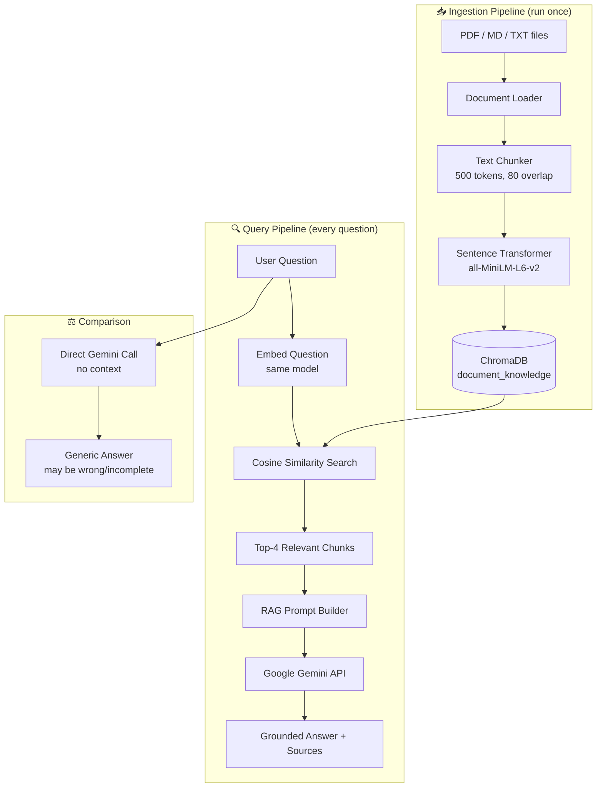

# 📚 Document RAG Assistant

> A complete, working Retrieval-Augmented Generation (RAG) application that answers questions about your documents using ChromaDB + Sentence-Transformers + Google Gemini.

---

## 📋 Table of Contents

1. [Project Overview](#project-overview)
2. [Problem Statement](#problem-statement)
3. [What is RAG?](#what-is-rag)
4. [System Architecture](#system-architecture)
5. [Technologies Used](#technologies-used)
6. [Project Structure](#project-structure)
7. [Document Ingestion Workflow](#document-ingestion-workflow)
8. [Chunking Explanation](#chunking-explanation)
9. [Embedding Generation](#embedding-generation)
10. [ChromaDB Storage](#chromadb-storage)
11. [Retrieval Process](#retrieval-process)
12. [Gemini Answer Generation](#gemini-answer-generation)
13. [Installation](#installation)
14. [Environment Setup](#environment-setup)
15. [Running the Project](#running-the-project)
16. [Testing](#testing)
17. [RAG vs Without RAG Comparison](#rag-vs-without-rag-comparison)
18. [Limitations & Future Improvements](#limitations--future-improvements)

---

## 🎯 Project Overview

**Document RAG Assistant** is a full-stack AI application that allows users to ask natural-language questions about their own documents (PDFs, Markdown, TXT files) and receive accurate, source-grounded answers.

The system uses **Retrieval-Augmented Generation (RAG)** — a technique that retrieves relevant document chunks from a vector database and injects them into an LLM prompt, allowing the model to answer questions about private, up-to-date, or domain-specific content that it was never trained on.

---

## ❓ Problem Statement

Large Language Models (LLMs) like Gemini have a critical limitation: **they only know what they were trained on**. They cannot answer questions about:

- Your private documents and internal knowledge bases
- Recent information published after their training cutoff
- Specific configuration values, project-specific facts, or proprietary data

**RAG solves this problem** by dynamically retrieving relevant information from your own documents at query time and providing that content to the LLM as context.

---

## 🧠 What is RAG?

**Retrieval-Augmented Generation (RAG)** = Retrieval + Generation

```
User Question
      │
      ▼
[Embed Question]  ──→  Vector (384 numbers)
      │
      ▼
[Search ChromaDB]  ──→  Top-4 most similar document chunks
      │
      ▼
[Build RAG Prompt]  ──→  "Here are the retrieved docs... Answer: {question}"
      │
      ▼
[Gemini LLM]  ──→  Grounded answer with source citations
```

The key insight: the LLM is not asked to recall from memory — it's given the relevant text and asked to reason from it.

---

## 🏗️ System Architecture



---

## 🛠️ Technologies Used

| Component | Technology | Why |
|-----------|-----------|-----|
| Language | Python 3.10+ | Ecosystem for AI/ML |
| Vector Database | ChromaDB 0.5.x | Free, local, persistent, easy to use |
| Embedding Model | sentence-transformers/all-MiniLM-L6-v2 | Free, local, 384-dim, fast |
| LLM | Google Gemini (`gemini-2.5-flash`) | State-of-the-art, generous free tier |
| Gemini SDK | google-genai (official) | Official Python SDK |
| UI | Streamlit | Fast to build, great for demos |
| PDF Parsing | PyPDF | Pure Python, no system deps |
| Environment | python-dotenv | Secure API key management |
| Testing | pytest | Standard Python testing |

---

## 📁 Project Structure

```
RAG/
│
├── app.py                    ← Streamlit UI (main entry point)
├── requirements.txt          ← Python dependencies
├── .env                      ← Your API key (not committed to Git)
├── .env.example              ← Template for .env
├── .gitignore                ← Excludes .env, chroma_db/, etc.
├── README.md                 ← This file
│
├── src/                      ← Core application modules
│   ├── __init__.py
│   ├── document_loader.py    ← Load PDF, MD, TXT files
│   ├── text_chunker.py       ← Split documents into chunks
│   ├── embeddings.py         ← Generate vector embeddings
│   ├── vector_store.py       ← ChromaDB operations
│   ├── retriever.py          ← Semantic similarity search
│   ├── generator.py          ← Gemini API integration
│   └── rag_pipeline.py       ← Orchestrates all components
│
├── scripts/
│   ├── download_docs.py      ← Download Chroma documentation
│   ├── ingest.py             ← Run the full ingestion pipeline
│   └── evaluate.py           ← Evaluate retrieval quality
│
├── data/
│   └── source_docs/          ← Your documents go here
│       ├── 01_getting_started.md
│       ├── 02_introduction.md
│       ├── ...               ← Chroma documentation pages
│       └── project_facts.md  ← Special RAG demo document
│
├── chroma_db/                ← Persistent ChromaDB storage (auto-created)
│
└── tests/
    ├── __init__.py
    ├── test_chunking.py      ← Unit tests for text splitting
    ├── test_retrieval.py     ← Unit tests for ChromaDB + retrieval
    └── test_rag_pipeline.py  ← Integration tests for full pipeline
```

---

## 📥 Document Ingestion Workflow

```
1. Load Files
   └── document_loader.py reads PDF/MD/TXT from data/source_docs/

2. Split into Chunks
   └── text_chunker.py splits each document into ~500-token overlapping pieces

3. Generate Embeddings
   └── embeddings.py converts each chunk to a 384-dimensional vector
       using sentence-transformers/all-MiniLM-L6-v2 (runs locally, free)

4. Store in ChromaDB
   └── vector_store.py upserts chunks + embeddings + metadata into
       the 'document_knowledge' collection at chroma_db/
```

Run ingestion with:
```bash
python scripts/ingest.py
```

---

## ✂️ Chunking Explanation

**Why chunk at all?**
- Embedding models have a maximum input length (~512 tokens)
- LLMs have context window limits
- Smaller chunks allow more precise retrieval (you want the paragraph about "upsert", not the whole chapter)

**Our strategy:**

| Setting | Value | Reason |
|---------|-------|--------|
| Chunk size | ~500 tokens | ≈375 words; fits in embedding model, meaningful context |
| Chunk overlap | ~80 tokens | ≈60 words; prevents information loss at boundaries |
| Split boundary | Paragraph first, then sentence | Preserves natural structure |

**What is chunk overlap?**

```
Chunk 1: [paragraph A] [paragraph B] [paragraph C]
Chunk 2:               [paragraph B] [paragraph C] [paragraph D]
                       ↑─── 80 token overlap ───↑
```

The overlap ensures that if the answer spans a chunk boundary, one of the chunks will contain the full context.

---

## 🔢 Embedding Generation

We use **sentence-transformers/all-MiniLM-L6-v2**:

- **Runs entirely locally** — no API key needed for embedding
- Produces **384-dimensional vectors** for each piece of text
- Trained specifically for **semantic similarity** tasks
- Used for **both** indexing (at ingest time) and querying (at search time)

```python
from sentence_transformers import SentenceTransformer
model = SentenceTransformer("sentence-transformers/all-MiniLM-L6-v2")
embedding = model.encode("How do I add documents to ChromaDB?")
# → [0.021, -0.134, 0.089, ...] (384 numbers)
```

**Critical rule:** The same model must be used for both ingestion and querying. Using different models produces incompatible vector spaces.

---

## 🗄️ ChromaDB Storage

ChromaDB is our vector database. It stores:
1. The chunk **text** (for display in results)
2. The chunk **embedding** (for similarity search)
3. The chunk **metadata** (source file, title, URL, chunk index)

**Key design decisions:**

| Decision | Implementation |
|----------|---------------|
| Persistence | `PersistentClient(path="chroma_db/")` — survives restarts |
| Duplicate prevention | `upsert()` instead of `add()` — same ID = update, not duplicate |
| Chunk IDs | `MD5(source_path + chunk_index)` — stable across re-runs |
| Distance metric | `cosine` — standard for sentence-transformer embeddings |
| Embedding function | `None` — we handle embeddings ourselves |

```python
# Distance scale with cosine metric:
# 0.0 = perfect match (identical vectors)
# 1.0 = orthogonal (unrelated)
# 2.0 = completely opposite
```

---

## 🔍 Retrieval Process

When a user asks a question:

```python
# 1. Embed the question (same model as ingestion)
query_embedding = embed_text("How do I create a collection?")

# 2. Search ChromaDB
results = collection.query(
    query_embeddings=[query_embedding],
    n_results=4,
    include=["documents", "metadatas", "distances"],
)

# 3. Format results with relevance scores
# relevance_score = 1 - cosine_distance  (higher = more relevant)
```

The top-4 most semantically similar chunks are returned with:
- Their text content
- Source document name, URL, chunk index
- Cosine distance + relevance score

---

## 🤖 Gemini Answer Generation

### RAG Mode (With Retrieved Context)

```python
prompt = f"""You are a document-based AI assistant.
Answer using ONLY the information in the retrieved context below.
Do not invent information. Cite your sources.

Retrieved Context:
{retrieved_chunks_text}

Question: {user_question}
Answer:"""
```

### Direct Mode (Without RAG)

```python
prompt = f"""You are a helpful AI assistant.
You have NO access to private documents or project configurations.
If asked about specific project values, say you don't have that information.

Question: {user_question}
Answer:"""
```

---

## 🚀 Installation

### Prerequisites
- Python 3.10 or higher
- pip

### Steps

```bash
# 1. Navigate to the project folder
cd path/to/RAG

# 2. (Recommended) Create a virtual environment
python -m venv venv
venv\Scripts\activate      # Windows
# source venv/bin/activate  # Mac/Linux

# 3. Install dependencies
pip install -r requirements.txt
```

> **Note:** The first install downloads ~500MB (sentence-transformers model weights). Subsequent runs use the cached model.

---

## ⚙️ Environment Setup

```bash
# Copy the template
copy .env.example .env

# Edit .env and add your Gemini API key
# GEMINI_API_KEY=your_actual_key_here
# GEMINI_MODEL=gemini-2.5-flash
```

Get a free Gemini API key at: https://aistudio.google.com/app/apikey

> **Without a Gemini API key:** Document ingestion, chunking, embedding, and retrieval all work. Only the final answer generation step requires the key.

---

## ▶️ Running the Project

### Step 1: Download the documentation dataset
```bash
python scripts/download_docs.py
```

### Step 2: Ingest documents into ChromaDB
```bash
python scripts/ingest.py
```

### Step 3: (Optional) Preview chunks before ingesting
```bash
python scripts/ingest.py --preview
```

### Step 4: Run the Streamlit app
```bash
streamlit run app.py
```
Then open http://localhost:8501 in your browser.

### Step 5: (Optional) Evaluate retrieval quality
```bash
python scripts/evaluate.py
```

---

## 🧪 Testing

```bash
# Run all tests
pytest tests/ -v

# Run specific test files
pytest tests/test_chunking.py -v
pytest tests/test_retrieval.py -v
pytest tests/test_rag_pipeline.py -v

# Run with output shown (useful for debugging)
pytest tests/ -v -s
```

### Verified Test & Evaluation Results

- **Documentation Dataset:** 17 official Chroma documentation pages downloaded (24,292 words total) + `project_facts.md` (318 words).
- **Ingestion:** 18 documents chunked into **81 chunks** and stored persistently in `chroma_db/` under collection `document_knowledge`.
- **Unit & Integration Tests (`pytest tests/ -v`):** **66 passed, 3 skipped** (the 3 `TestGeminiIntegration` tests are skipped when `GEMINI_API_KEY` is not configured).
- **Retrieval Evaluation (`python scripts/evaluate.py`):** **6/6** evaluation questions passed retrieval checks against the persistent `document_knowledge` collection.

> **Note:** End-to-end Gemini generation (both RAG and direct baseline) requires setting a valid `GEMINI_API_KEY` in `.env`. Without an API key, ingestion, embedding, persistent ChromaDB storage, and semantic retrieval all run locally.

---

## ⚖️ RAG vs Without RAG Comparison

### Demonstration Question

> *"What are the exact chunk size, overlap, embedding model, and ChromaDB collection name configured in this project?"*

This question is designed to have a definitive, project-specific answer that **only exists in `project_facts.md`** — a document that was never in Gemini's training data.

---

### Without RAG (Direct LLM)

Gemini only has its training knowledge — it cannot know project-specific configuration values:

```
Without RAG Answer:
I don't have access to the specific configuration of your project.
Without seeing your code or configuration files, I cannot tell you
the exact chunk size, overlap setting, embedding model name, or
ChromaDB collection name you are using. These are project-specific
values that you would need to look up in your source code or
configuration files.
```

---

### With RAG (Retrieved from project_facts.md)

ChromaDB retrieves the `project_facts.md` chunk, which contains the exact values:

```
With RAG Answer:
Based on the retrieved document "Document RAG Assistant - Project
Configuration Facts":

- Chunk Size: 500 tokens
- Chunk Overlap: 80 tokens
- Embedding Model: sentence-transformers/all-MiniLM-L6-v2
- ChromaDB Collection Name: document_knowledge
- Persistent Storage Directory: chroma_db/
- Top-K Retrieval Value: 4

Source: project_facts.md (local://project_facts)
```

This demonstrates that RAG can provide precise, accurate answers about private document content that the LLM was never trained on.

---

## ⚠️ Limitations & Future Improvements

### Current Limitations

| Limitation | Impact |
|-----------|--------|
| In-process ChromaDB | Cannot handle concurrent users (use Chroma HTTP server for multi-user) |
| Simple chunking | Fixed-size chunks may split tables or code blocks awkwardly |
| No re-ranking | Retrieved chunks are ordered by embedding distance only |
| Single collection | All documents share one collection (no per-user isolation) |
| No conversation memory | Each question is independent (no follow-up questions) |

### Future Improvements

1. **Hybrid search** — Combine embedding similarity with keyword (BM25) search
2. **Re-ranking** — Use a cross-encoder to re-rank retrieved chunks before sending to LLM
3. **Conversation history** — Add memory so users can ask follow-up questions
4. **Document metadata UI** — Filter by document type, date, or source before retrieval
5. **Chroma HTTP server** — Support multiple concurrent users
6. **Evaluation metrics** — Add RAGAS or similar RAG evaluation framework
7. **Streaming responses** — Stream Gemini's answer token-by-token for better UX
8. **Multi-modal** — Support image extraction from PDFs

---

## 📸 Screenshots

After running `streamlit run app.py`, the application shows:

- **Tab A** — Document Management: upload files, ingest, preview chunks
- **Tab B** — Ask Questions: RAG-powered Q&A with source citations
- **Tab C** — RAG vs Without RAG: side-by-side comparison demonstrating RAG's value

---

*Built as a college assignment demonstrating Retrieval-Augmented Generation with ChromaDB, Sentence-Transformers, and Google Gemini.*
